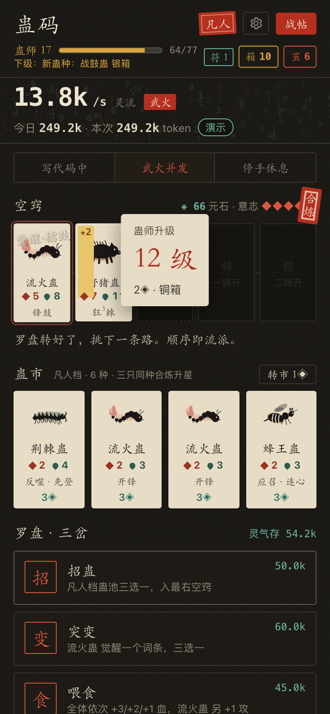
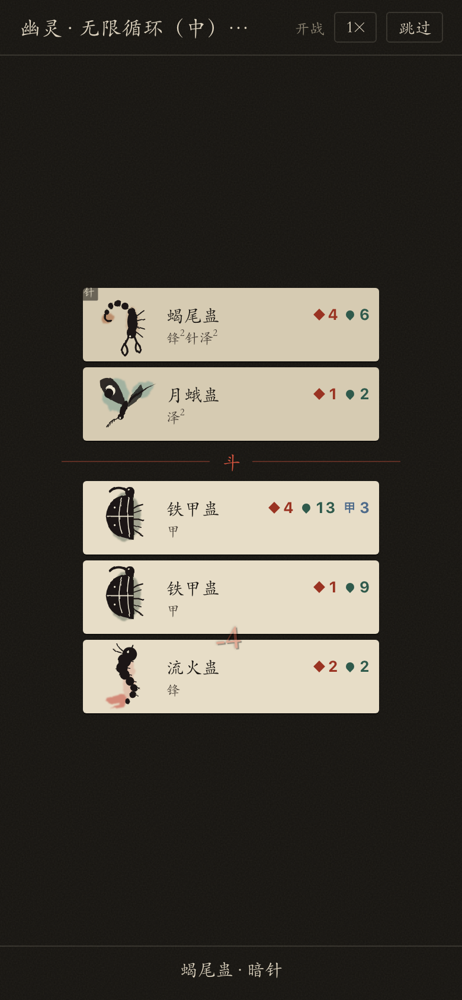
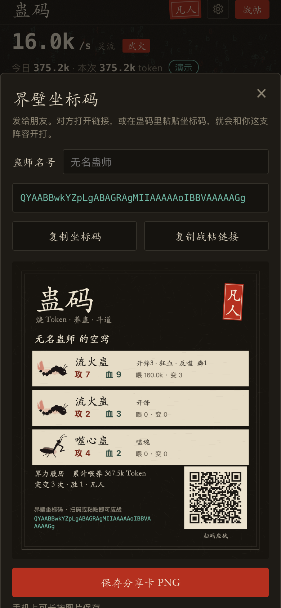
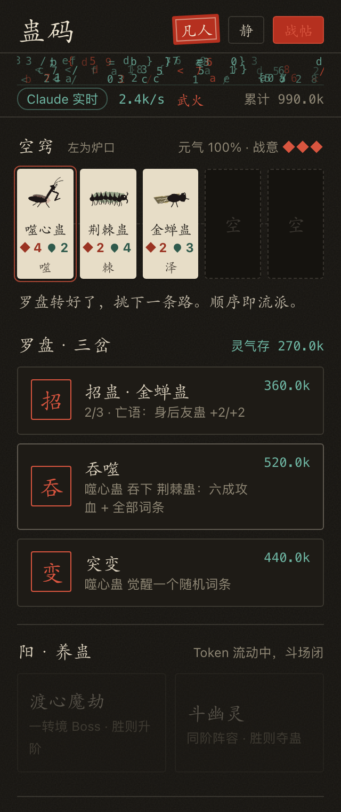

# 蛊码 GuCode

**烧 Token，养蛊，斗道。** 一个给 Vibe Coding 开发者的伴生自走棋。

你写代码时消耗的 token 就是蛊虫的口粮：AI 在干活，空窍里的时间就在流动，蛊沿你选的路生长；斗蛊随时可开，每场耗一点意志。

- 三岔路口选路：喂食、淬体、突变、分裂、吞噬、招蛊、炼附。走的顺序就是你的流派
- 五格蛊阵，主蛊配附蛊合出杀招（烈火三豕冲、金蝉脱壳、尸山月影……）
- 复制「界壁坐标码」发给朋友，对方打开链接就会和你这窝蛊开打

**在线试玩：** https://1596941391qq.github.io/gu-code/

| 养蛊 | 斗蛊 | 分享卡 |
|---|---|---|
|  |  |  |

## VS Code 插件

插件会读取本机 Claude Code（`~/.claude/projects`）和 Codex（`~/.codex/sessions`）会话记录里的 token 用量数字，用来推动游戏时间。它只读用量数字，不读对话内容，也不往外发任何东西。

```sh
sh tools/install-ext.sh   # 构建并复制到 ~/.vscode/extensions，然后在 VS Code 里执行 Developer: Reload Window
```

装好后侧边栏会出现「蛊码」，状态栏显示 `养蛊中 · 文火 / 武火`。



## 开发

纯静态，零依赖。改 `src/` 后执行 `node tools/build.mjs`，它会把源码打包成一个 `gucode.js`（`file://` 双击也能跑）。`node tools/sim.mjs` 跑平衡模拟。
