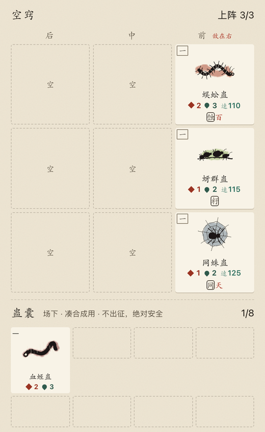
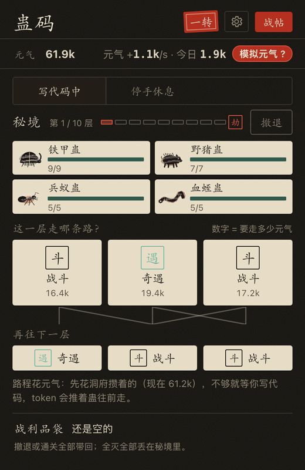
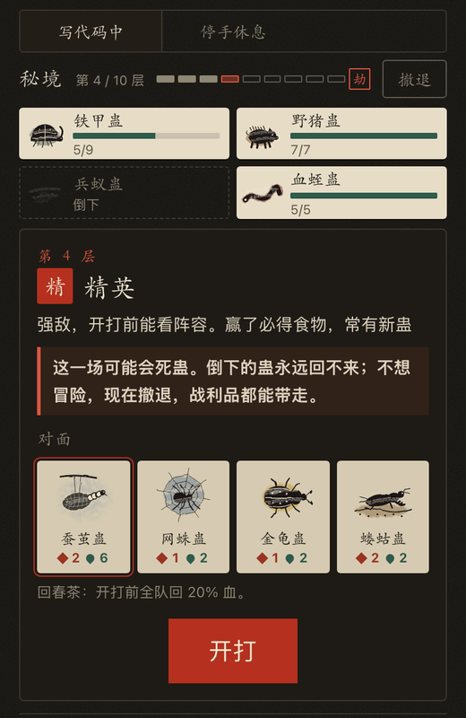
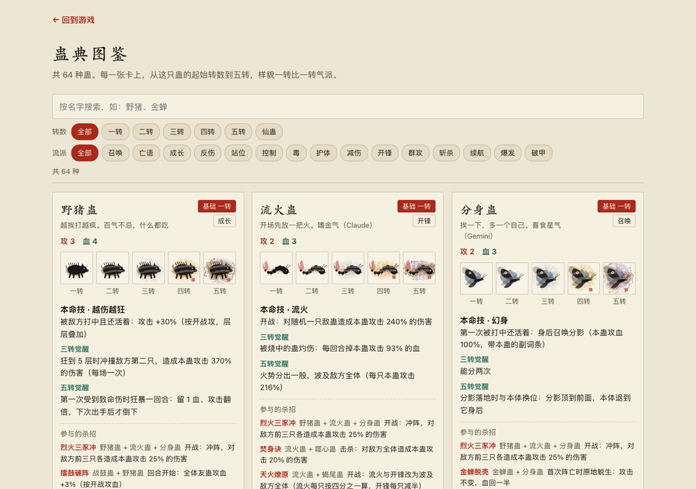

# 蛊码 GuCode

**烧 Token，养蛊，闯秘境。** 一个给 Vibe Coding 开发者的伴生自走棋。

你用 AI 写代码时消耗的 token 就是**元气**，全游戏只有这一种资源。在洞府里用元气买蛊、合蛊、排阵；带上阵的蛊进秘境闯关，你写代码，它们就往深处走。

> **v2 正在重做中**，下面是新版预览。线上网页目前还是旧版，v2 做完会直接替换，旧存档另存备份后从零开始。

- **洞府**：空窍是场上，蛊囊是场下；蛊市买蛊和食物，三只同种同转自动合成升一转，一转到五转样貌各不相同
- **3×3 阵盘**：双方各一块 3×3 阵盘，斜俯视对战。蛊有攻、血、速，出手顺序条显示谁先动，出手前先标出要打的格子；近战打同一行最前面的敌人，技能有整行、整列、十字、周围一圈等形状，还能击退、拉近
- **主动技与被动技**：每只蛊一个被动技能，约四成另有主动技能，蛊力攒满自动释放；三转、五转各觉醒一次
- **羁绊三层**：16 个原著流派（力道、炎道、冰雪道、宇道、宙道……）凑够只数触发共鸣；特定几只蛊同时上阵自动成杀招，杀招以核心蛊定品级、被同道共鸣放大，还能推演成进阶杀招；炎与冰雪、光与暗等异道相冲。一半以上的杀招跨道组成
- **秘境**：三条路的地图，能看到下一步；血量在一次出征里延续，**倒下的蛊永远回不来**；随时可以撤退带走战利品，全灭全丢
- **出战额度**：每个秘境写明额度，上阵蛊的转数加起来不能超过它，敌人也按同样的额度配。蛊养得再多，每一场也要靠搭配和站位赢
- **道途**：成就会逐步解锁新蛊、新食物、新秘境；不发数值奖励
- **彩蛋**：正在用 Claude 时，蛊获得「SOTA」，伤害 +1%

| 洞府与 3×3 阵盘 | 秘境地图 | 精英战前预警 |
|---|---|---|
|  |  |  |

**[蛊典图鉴](https://1596941391qq.github.io/gu-code/bestiary.html)**：全部蛊一转到五转的样貌、技能和杀招（新版会扩到 120 种，并加上杀招图鉴）。



## 两种玩法：网页版是演示，插件才吃真 token

| | 网页版 | VS Code 插件 |
|---|---|---|
| 地址 | https://1596941391qq.github.io/gu-code/ | 见下方安装 |
| token 从哪来 | **模拟的「演示灵流」**，网页读不到你电脑上的 AI 用量 | **真实消耗**：实时读取本机 AI 编程工具的用量数字 |
| 适合 | 先试试手感、接朋友的战帖 | 日常边写代码边养 |

网页版界面左上角会标「演示」。想让你真实烧掉的 token 喂蛊，请装插件。

### 安装插件（获取真实 token 消耗）

目前需要从源码装，一条命令（macOS / Linux；Windows 用 Git Bash 执行同一条）：

```sh
git clone https://github.com/1596941391qq/gu-code && cd gu-code
sh tools/install-ext.sh
```

然后在 VS Code 里执行一次 `Developer: Reload Window`。侧边栏会出现「蛊码」，右下角状态栏显示养蛊进度。之后再更新，插件会自动热更新游戏，不用重启。

打包好的 `.vsix`（下载后在 VS Code 里「从 VSIX 安装」）会在下一个版本放到 Releases。

### 支持哪些 AI 编程工具

| 工具 | 状态 |
|---|---|
| Claude Code（含子 agent、多个配置目录） | ✅ 已支持 |
| OpenAI Codex CLI | ✅ 已支持 |
| Gemini CLI、Qwen Code、OpenCode、GitHub Copilot CLI、Cline / Roo / Kilo、Aider 等 | 🚧 适配中，见 `docs/adapters.md`（随下个版本发布） |

同时用多个工具、多个账号时，消耗会全部加总，并按来源分别显示实时速率。多台电脑也能汇总（用 `tools/gu-bridge.mjs`，下个版本发布）。

### 隐私

插件只读会话记录里的 **token 用量数字**，不读对话内容，也不联网。网页版以后会有可关闭的匿名游玩统计（只记每阶用了多久、在哪一步离开，不记身份），详见 `docs/privacy.md`（随下个版本发布）。

## 开发进度

为了避免多人撞车：**动手前先在对应 issue 下留言认领**；表里标「核心团队进行中」的部分请先别改，可以在 issue 里提建议。

**已完成**
- 已上线：网页版、VS Code 插件、分享卡与二维码、界壁坐标码、复盘链接、插件热更新、蛊典图鉴页
- 已做完、随 v2 一起上线：多工具多账号的 token 汇总与分来源实时速率；插件只认真实 token，网页版存档标「试玩」；算力履历（每日 token 曲线、消耗日历、5 小时 / 每周额度）

**核心团队进行中（v2 重做）**
- 核心循环：洞府养蛊池（单只蛊五转封顶）+ 每个秘境的出战额度，敌人按额度配
- 3×3 阵盘战斗：速度与出手顺序条、出手预告、蛊力与主动技、技能形状、击退拉近、结算页
- 斜俯视战斗画面，每个杀招独立动画
- 秘境：地图、奇遇、篝火、坊市、精英、首领渡劫、永久死亡、撤退与全灭
- 120 种蛊，按原著流派分 16 道；约 33 个杀招和 9 个进阶杀招；24 种食物；约 40 条道途
- 蛊典图鉴按道筛选，新增杀招图鉴

**欢迎认领**
- 适配更多 AI 编程工具（照 `docs/adapters.md` 加一个适配器）
- 英文 / 繁中翻译
- 新蛊种、新杀招的点子（开 issue 用「新蛊 / 杀招 / 玩法点子」模板）
- 音效、水墨插画

## 开发

纯静态，零依赖。改 `src/` 后执行 `node tools/build.mjs`，把源码打包成一个 `gucode.js`（`file://` 双击也能跑）。`node tools/sim.mjs` 跑平衡模拟。

## 开源与贡献

MIT 许可，欢迎任何形式的贡献，见 [CONTRIBUTING.md](CONTRIBUTING.md)。晒阵容、约战、聊平衡去 [Discussions](https://github.com/1596941391qq/gu-code/discussions)。
