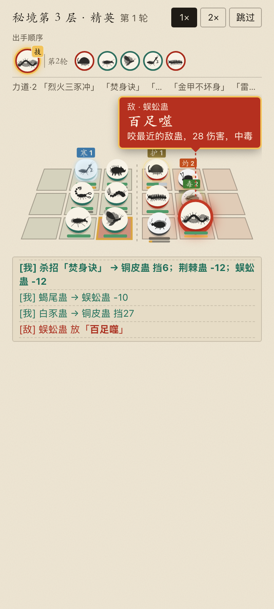
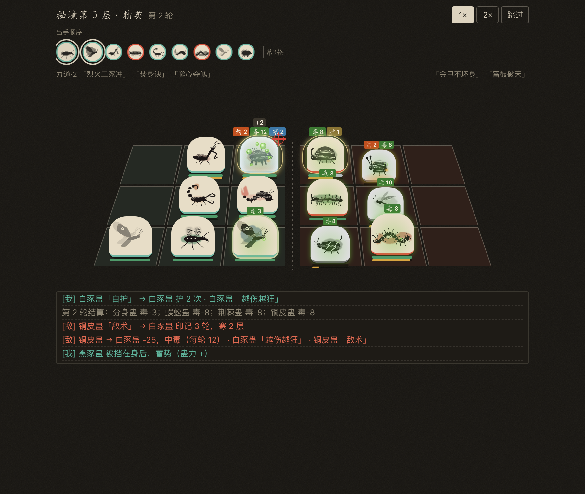

# 蛊码 GuCode

**烧 Token，养蛊，闯秘境。** 一个给 Vibe Coding 开发者的伴生自走棋。

你用 AI 写代码时消耗的 token 就是**元气**，全游戏只有这一种资源。在洞府里用元气买蛊、合蛊、排阵；带上阵的蛊进秘境渡劫，你写代码，它们就往深处走。

> **v2 已上线**：网页版和插件都换成了新版。旧存档另存了一份备份，新版从零开始。

- **洞府**：空窍是场上，蛊囊是场下；蛊市买蛊和食物，三只同种同转自动合成升一转。一转到五转样貌各不相同，蛊详情里写清每一转的攻、血和技能数字
- **3×3 阵盘**：双方各一块 3×3 阵盘，斜俯视对战。蛊有攻、血、速，出手顺序条显示谁先动；近战打同一行最前面的敌人，技能有整行、整列、十字、周围一圈等形状，还能击退、拉近
- **看得清的战斗**：放主动技先蓄势、再亮出技能牌（谁放的、哪一招、多少伤害）；出手顺序条提前标出谁要放大招；灼、毒、寒、护、标记挂在蛊头顶，带层数；阵盘下方滚动战斗记录；每个杀招有自己的动画
- **主动技与被动技**：每只蛊一个被动技能，约四成另有主动技能，蛊力攒满自动释放；三转、五转各觉醒一次
- **羁绊三层**：16 个原著流派（力道、炎道、冰雪道、宇道、宙道……）凑够只数触发共鸣；特定几只蛊同时上阵自动成杀招，杀招以核心蛊定品级、被同道共鸣放大，还能推演成进阶杀招；有的杀招只认低转蛊。炎与冰雪、光与暗等异道相冲
- **秘境**：13 个秘境，用原著地名（青茅山、南疆、北原、西漠、东海、琅琊福地、义天山、宝黄天、天庭……）。一进去整张十层地图都画好，能走的格子点亮；血量在一趟渡劫里延续。**一场打赢，倒下的蛊全部救回；打输，场上的蛊全部永久死亡**。精英和首领开打前写明阵容，不想冒险就退出秘境，战利品都能带走。渡劫成功首领必掉一样东西，二选一
- **出战额度**：每个秘境写明额度，上阵蛊的转数加起来不能超过它，敌人也按同样的额度配。蛊养得再多，每一场也要靠搭配和站位赢
- **试阵**：渡劫前拿当前阵容和幽灵、本秘境精英或任意一伙首领模拟，能看一场，也能连打 20 场看胜率；不花元气、不死蛊
- **食物**：51 种。除了加攻加血，还有挂在蛊身上的挂件、只管下一场的战斗食物、合炼丹、换位符、升转露、转市令等
- **每趟都不一样**：随机天象（雷雨、毒雾、寒夜……）、每个秘境多个首领各带一条克制机制、只管这一趟的秘境祝福、劫一到劫十的进阶难度；劫五以上首次渡过能挑一只仙蛊
- **道途**：50 条成就逐步解锁新蛊、新食物、新秘境；不发数值奖励
- **平衡**：同额度对局里，120 种蛊胜率都在 42%～59%，16 个道在 45%～58%，怎么分配转数都不超过 60%。`node tools/sim.mjs` 可以复现
- **彩蛋**：正在用 Claude 时，蛊获得「SOTA」，伤害 +1%

| 洞府与 3×3 阵盘 | 秘境整张地图 | 战斗：技能牌与战斗记录 | 精英战前预警 |
|---|---|---|---|
|  |  |  |  |



**[蛊典图鉴](https://1596941391qq.github.io/gu-code/bestiary.html)**：120 种蛊按 16 个道分节，一转到五转的样貌、每转攻血和技能；65 个杀招（含进阶杀招和低转杀招，配方默认折叠，免得剧透）；51 种食物。


## 两种玩法：网页版是演示，插件才吃真 token

| | 网页版 | VS Code 插件 |
|---|---|---|
| 地址 | https://1596941391qq.github.io/gu-code/ | 见下方安装 |
| token 从哪来 | **模拟元气**，网页读不到你电脑上的 AI 用量 | **真实消耗**：实时读取本机 AI 编程工具的用量数字 |
| 适合 | 先试试手感、接朋友的战帖 | 日常边写代码边养 |

网页版的存档会标「试玩」，分享出去的坐标码和战帖也带这个标。想让你真实烧掉的 token 喂蛊，请装插件。

### 安装插件（获取真实 token 消耗）

目前需要从源码装，一条命令（macOS / Linux；Windows 用 Git Bash 执行同一条）：

```sh
git clone https://github.com/1596941391qq/gu-code && cd gu-code
sh tools/install-ext.sh
```

然后在 VS Code 里执行一次 `Developer: Reload Window`。侧边栏会出现「蛊码」，右下角状态栏显示养蛊进度。之后再更新，插件会自动热更新游戏，不用重启。

打包好的 `.vsix`（下载后在 VS Code 里「从 VSIX 安装」）会在下一个版本放到 Releases。

### 支持哪些 AI 编程工具

Claude Code（含子 agent、多个配置目录、接 GLM 等兼容 API）、OpenAI Codex CLI、Gemini CLI、Qwen Code、GitHub Copilot CLI、Cline / Roo / Kilo、OpenCode、Droid、Amp、Kimi CLI、Aider 等都已支持。完整列表、路径和换算口径见 [docs/adapters.md](docs/adapters.md)。

同时用多个工具、多个账号时，消耗会全部加总，并按来源分别显示实时速率。多台电脑也能汇总（`tools/gu-bridge.mjs`）。

### 隐私

插件只读会话记录里的 **token 用量数字**，不读对话内容，也不联网。

## 开发进度

为了避免多人撞车：**动手前先在对应 issue 下留言认领**。

**已上线（v2）**
- 网页版、VS Code 插件（热更新）、分享卡与二维码、界壁坐标码、复盘链接、蛊典图鉴页
- 多工具多账号的 token 汇总与分来源实时速率；算力履历（每日 token 曲线、消耗日历、5 小时 / 每周额度）
- 核心循环：洞府养蛊池（单只蛊五转封顶）+ 每个秘境的出战额度，敌人按额度配
- 3×3 阵盘与战斗引擎；战斗画面（蓄势亮牌、出手预告、状态图标、战斗记录、每个杀招的动画、结算页）
- 秘境：整张地图、天象、首领机制、秘境祝福、劫一到劫十、仙蛊；试阵
- 120 种蛊、65 个杀招、51 种食物，全部配了水墨画；50 条道途；数值平衡

**接下来**
- 打包 `.vsix` 放到 Releases
- 音效

**欢迎认领**
- 适配更多 AI 编程工具（照 `docs/adapters.md` 加一个适配器）
- 英文 / 繁中翻译
- 新蛊种、新杀招的点子（开 issue 用「新蛊 / 杀招 / 玩法点子」模板）
- 音效、水墨插画

## 开发

纯静态，零依赖。改 `src/` 后执行 `node tools/build.mjs`，把源码打包成一个 `gucode.js`（`file://` 双击也能跑）。自检：`node tools/sim.mjs`（平衡模拟）、`node tools/trip-test.mjs`（秘境）、`node tools/meta-test.mjs`（道途与存档）。规则正本在 [docs/design.md](docs/design.md)。

## 开源与贡献

MIT 许可，欢迎任何形式的贡献，见 [CONTRIBUTING.md](CONTRIBUTING.md)。晒阵容、约战、聊平衡去 [Discussions](https://github.com/1596941391qq/gu-code/discussions)。
